<div align="center">

<picture>
  <source media="(prefers-color-scheme: light)" srcset="hero-light.svg" />
  
</picture>

<br/>

<a href="#about"></a>
<a href="#projects"></a>
<a href="#research"></a>
<a href="#building"></a>
<a href="#stack"></a>
<a href="#contact"></a>

</div>

<br/>

<h2><a id="about"></a>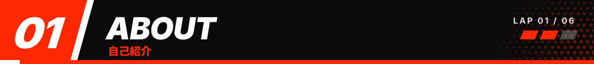</h2>

<table>
<tr>
<td width="42%" valign="middle">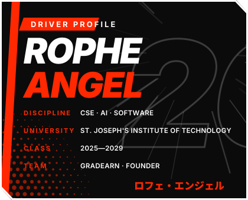</td>
<td valign="middle">
I'm Rophe, a Computer Science and Engineering undergraduate at St. Joseph's Institute of Technology (2025–2029).<br/><br/>
I pick a practical problem, build a rough version, and learn from wherever it breaks.<br/><br/>
Right now that sits between AI applications, software and research. Still learning, always building something small.<br/><br/>
<sub>Off the track: Formula 1, anime, music, and ideas that don't fit neatly into one category.</sub>
</td>
</tr>
</table>

<br/>

<h2><a id="projects"></a>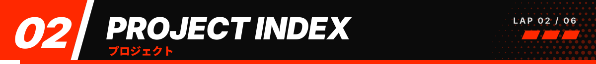</h2>

<table>
<tr>
<td width="34%" valign="middle">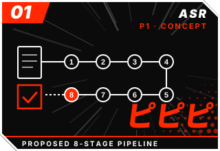</td>
<td valign="top">
<b>01 · ASSURE</b> &nbsp;<code>CONCEPT · RESEARCH IN PROGRESS</code><br/>
An AI-assisted system concept for tender documents: simplify dense requirements, explain what each one asks for, and flag the mandatory submission documents. Explores information extraction, retrieval-augmented generation and traceability through a proposed eight-stage pipeline.<br/>
<sub><b>My part:</b> conceptualization and research. Not yet confirmed as implemented or validated. &nbsp;·&nbsp; <a href="https://github.com/ropheangel1312-design/Assure---Demo">Repository →</a></sub>
</td>
</tr>
<tr>
<td valign="top">
<b>02 · Jana Nayagan</b> &nbsp;<code>PROTOTYPE</code><br/>
A civic complaint-management platform exploring how citizen issue reports become trackable administrative work: dashboards, hotspots, filters, overdue indicators and AI-assisted text and image analysis. React, TypeScript, Vite and Google GenAI.<br/>
<sub><b>My part:</b> research, presentation, frontend/UI. UI has progressed; backend integration and evaluation are still open. &nbsp;·&nbsp; <a href="https://github.com/ropheangel1312-design/Jana-Nayagan">Repository →</a></sub>
</td>
<td width="34%" valign="middle"></td>
</tr>
<tr>
<td width="34%" valign="middle"></td>
<td valign="top">
<b>03 · HUSH</b> &nbsp;<code>PERSONAL PROJECT</code><br/>
A Spotify-inspired listening experience wrapped in a dark liquid-glass interface. It explores the Spotify Web API and Web Playback SDK, including the quirks of browser playback. Built with HTML, CSS and JavaScript.<br/>
<sub><b>My part:</b> UI and feature planning, Spotify integration, playback debugging, testing. Playback behaviour has needed debugging. &nbsp;·&nbsp; Repository link to be added.</sub>
</td>
</tr>
<tr>
<td valign="top">
<b>04 · LOCK IN</b> &nbsp;<code>CONCEPT · MVP PLANNING</code><br/>
A study companion pairing educational YouTube lectures with your own soundtrack, each controlled independently, plus an optional study timer. Planned as a web app and a Chrome extension. Nothing is implemented or tested yet. <i>"Locked. Loaded. Let's go."</i><br/>
<sub><b>Proposed stack (not built):</b> React, TypeScript, Vite, HTML Audio API, YouTube IFrame Player API, Chrome Manifest V3.</sub>
</td>
<td width="34%" valign="middle">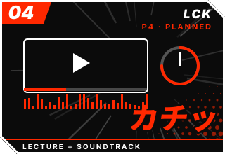</td>
</tr>
<tr>
<td width="34%" valign="middle">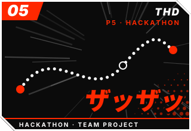</td>
<td valign="top">
<b>05 · Thadam</b> &nbsp;<code>HACKATHON PROJECT</code><br/>
A collaborative hackathon project built with a team. Python, Claude, Salesforce and Agentforce were explored in the wider hackathon context; the repository's own feature set and stack are still to be confirmed and described here.<br/>
<sub><b>My part:</b> research, presentation deck, frontend. &nbsp;·&nbsp; <a href="https://github.com/SomeNobody21112/Thadam">Repository →</a></sub>
</td>
</tr>
<tr>
<td valign="top">
<b>06 · ICHNOVA</b> &nbsp;<code>HACKATHON PROJECT</code><br/>
A collaborative hackathon project built with a team. A fuller description will follow once the repository's functionality and technology stack have been checked, rather than guessed at.<br/>
<sub><b>My part:</b> research, presentation deck, frontend. &nbsp;·&nbsp; <a href="https://github.com/SomeNobody21112/ICHNOVA">Repository →</a></sub>
</td>
<td width="34%" valign="middle">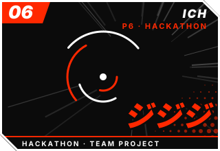</td>
</tr>
</table>

<br/>


**Also on the grid**

| | |
|---|---|
| **SAMAY & SAAKSHI** &nbsp;`TEAM CONCEPT / PAPER`<br/>A proposed multi-source evidence engine for MSMEs, combining logistics, GSTN and banking evidence to support receivables verification and legal enforcement. Not deployed or validated.<br/><sub>With Sri Raamanuja Dasan, Kannan Y and Joyce Blessy.</sub> | **GradEarn** &nbsp;`FOUNDER`<br/>A student-focused initiative covering freelancing guidance, practical career skills, portfolios, client communication, scam awareness and innovation/hackathon coaching. EVOLVEN's coaching work now lives here.<br/><sub>Co-founded with Saisaran and Darshan. &nbsp;·&nbsp; <a href="https://www.instagram.com/gradearn.in/">Instagram →</a></sub> |

<br/>

<h2><a id="research"></a></h2>

No paper below is published or peer-reviewed. These are manuscripts in development.

| № | Title | Abstract | Status |
|---|---|---|---|
| R-01 | **ASSURE** | Proposed AI-assisted tender-document intelligence framework. | Unpublished manuscript in development |
| R-02 | **Jana Nayagan** | Civic complaint-management platform: concept and prototype study. | Unpublished manuscript in development |
| R-03 | **SAMAY & SAAKSHI** | Proposed MSME receivables evidence and verification concept. <br/><sub>Sri Raamanuja Dasan, Kannan Y, Rophe Angel, Joyce Blessy.</sub> | Concept / paper · manuscript in progress |

<br/>

<h2><a id="building"></a>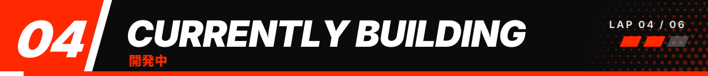</h2>

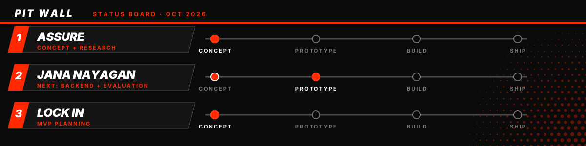

<br/>

<h2><a id="stack"></a>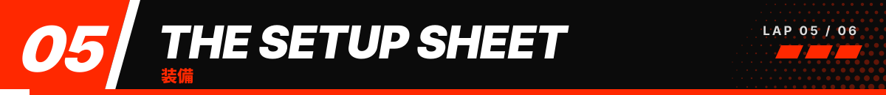</h2>

| Race-ready<br/><sub>used in projects</sub> | Practice<br/><sub>learning</sub> | Simulator<br/><sub>proposed, not yet built</sub> | Test track<br/><sub>explored</sub> |
|---|---|---|---|
| JavaScript · HTML · CSS<br/>TypeScript · React · Vite<br/>Spotify Web API and Playback SDK<br/>Google GenAI<br/>Python (hackathons) | Java | HTML Audio API<br/>YouTube IFrame Player API<br/>Chrome Manifest V3<br/><sub>(for LOCK IN)</sub> | Claude<br/>Salesforce<br/>Agentforce |

<br/>

<h2><a id="contact"></a>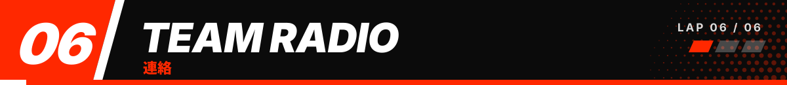</h2>

<div align="center">

<a href="https://github.com/ropheangel1312-design">GitHub</a> &nbsp;·&nbsp;
<a href="https://www.linkedin.com/in/rophe-angel-b8a051370/">LinkedIn</a> &nbsp;·&nbsp;
<a href="https://www.instagram.com/gradearn.in/">GradEarn on Instagram</a> &nbsp;·&nbsp;
<a href="https://rophe.vercel.app/">Portfolio</a>

</div>

<details>
<summary><b>▸ Press to talk: team radio</b></summary>

<br/>

```text
ENGINEER   Rophe, how's the pace?
ROPHE      Still learning. Still building something small.
ENGINEER   Any claims for the record?
ROPHE      Nothing until it's validated. Nothing "completed" until it is.
ENGINEER   Copy that. Box, box.
```

</details>

<br/>

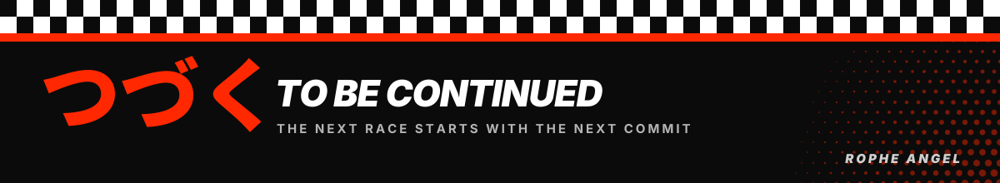
